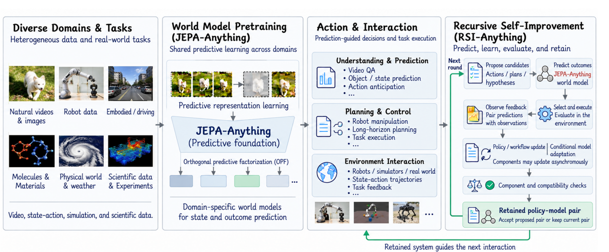
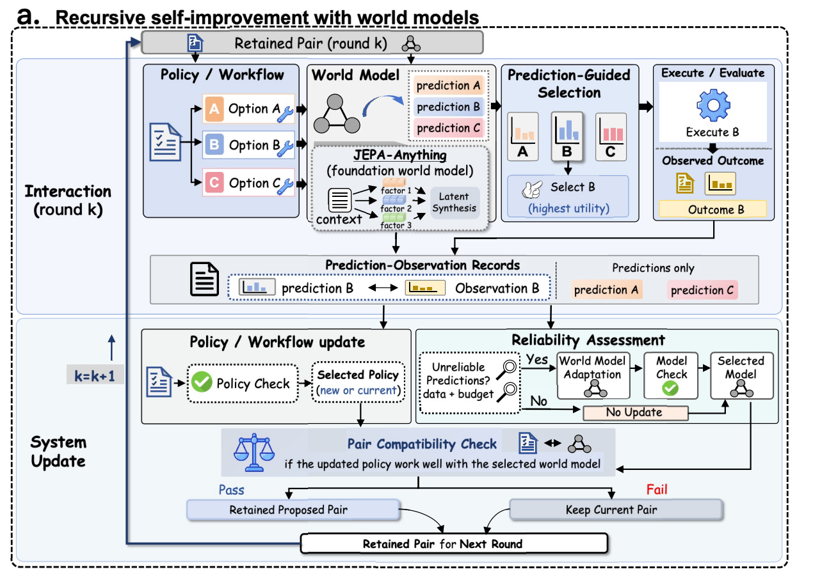
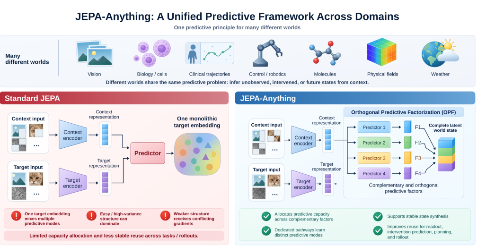
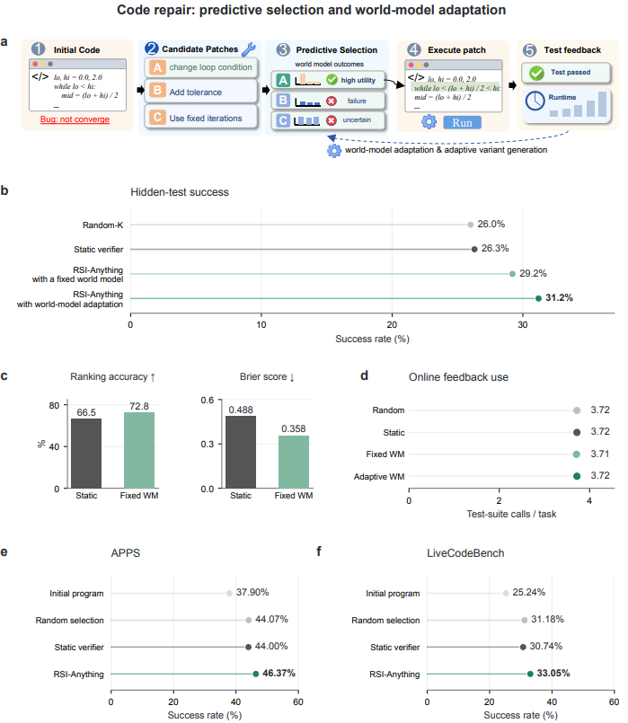
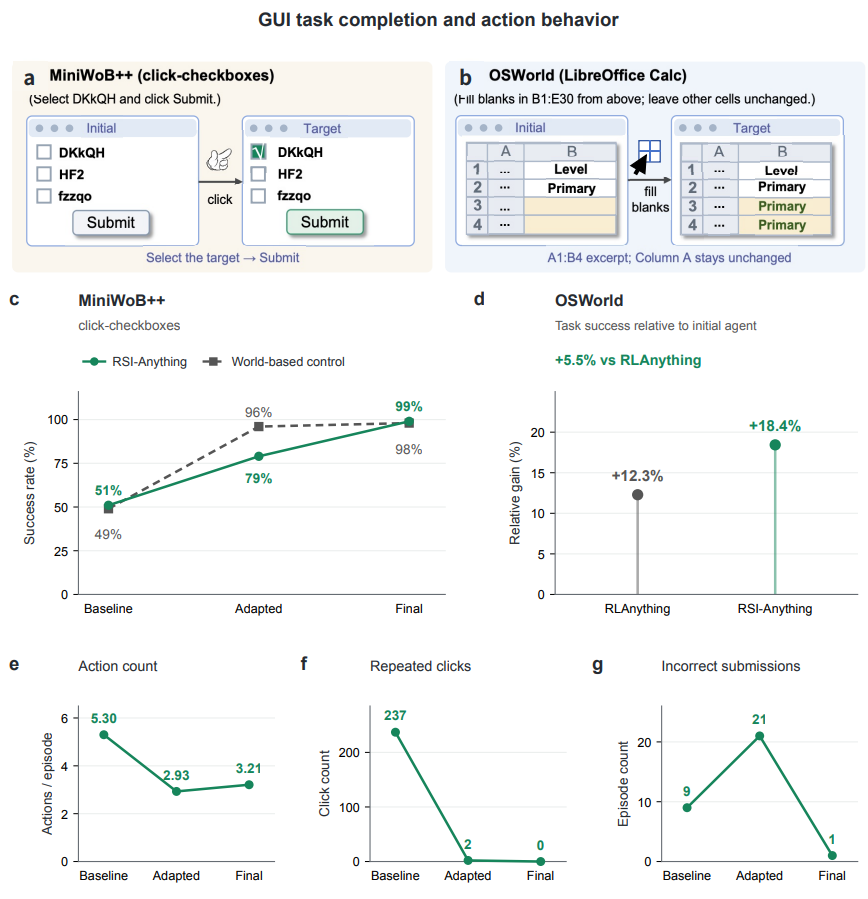
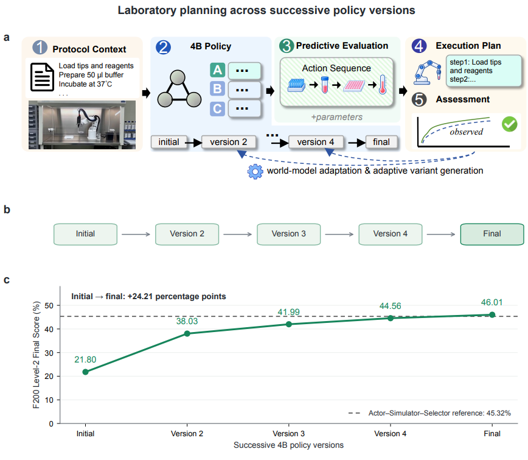
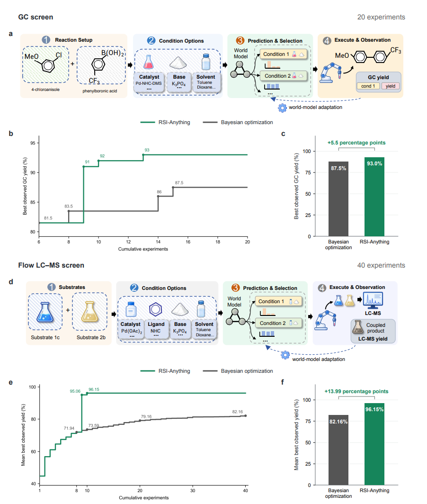
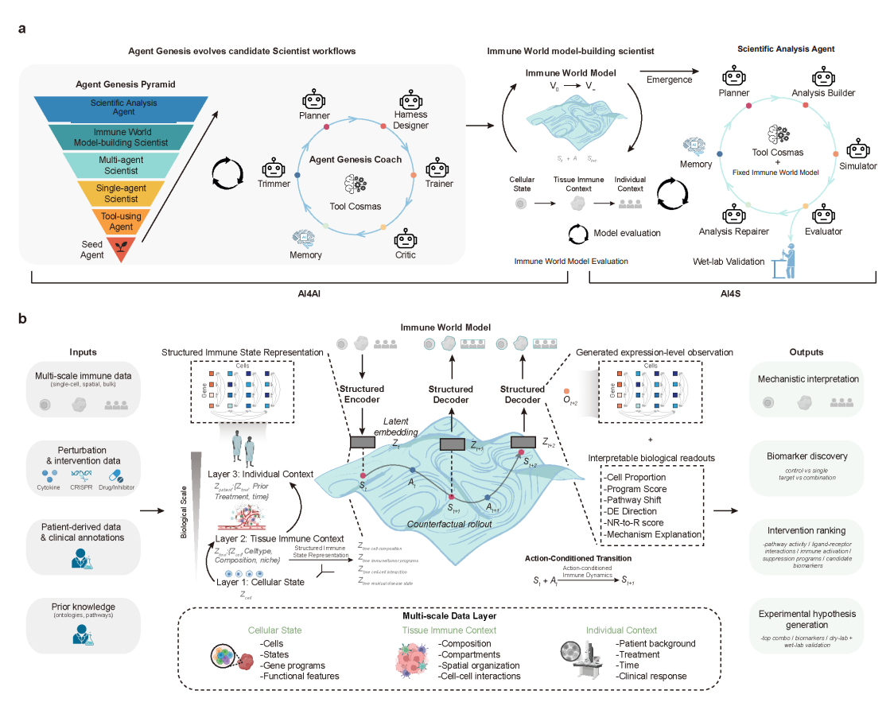

# RSI-Anything: Unlocking Recursive Self-Improvement with World Models
https://arxiv.org/abs/2610.13912
(まとめ @n-kats)

# 著者
* Taoyong Cui
* Pinxian Zeng
* Wanghan Xu
* Hao Xiao
* Shuhan Xue
* Qiang Gao
* Wanli Ouyang
* Pheng Ann Heng
* Zhenfei Yin
* Yingcheng Wu
* Ling Yang

PhAI Labs のメンバー

# どんなもの？
いろんな問題に使えるRSI（Recurrent Self Improvement, 再帰的自己改善）のフレームワークを提案し、それに基づく実験を紹介する論文。

ワールドモデル（広い意味で）を用いることが特徴。

＊RSI: ボードゲームAIの自己対戦による学習のように、自律的に改善する話

# 先行研究と比べてどこがすごい？
既存手法との違いは、広い意味でのワールドモデルを用いること。自己改善の一つとして、そのワールドモデルも改善することがある。

特に、ワールドモデルとしてJEPA-Anything（著者らの前作（2週前の））を使い、科学実験で広く適用できる設定をカバーしている。ただし、必ずしもこれを使うわけではない（選択の自由度がある）。

# 技術や手法の肝は？
## フレームワーク

- 何らかの方策に基づいて、ワールドモデルを操作して実験設定を選ぶ
- 実験結果を予測しつつ、実験を行う
- その結果を改善に使うかを検討する
  - 方策やワールドモデル改善に有効か評価
- 有効ならそれを記録・反映

### 注意
ワールドモデルを使って考えてた設定は、単にベストなものを選ぶのではなく、確信度に基づくペナルティをいれたりする工夫がある。
（乱数を使った選択をしたりも有効なはず）

## RSIAnythingを動かすのに用いるもの

* 文脈
* 状態の集合
* アクションの集合
* ワールドモデル
* バリデーター
* 評価方法
* コスト情報
* 予算情報

## JEPA-Anything
[https://arxiv.org/abs/2609.20800](https://arxiv.org/abs/2609.20800) で提案された手法。

状態を潜在ベクトル化して、潜在ベクトルベースで操作・シミュレーションができる（MuZeroに近い手法）。

OPF（orthogonal predictive factorization）を使って低次元化し、直交する直交する主要な要素に関する部分だけを抽出する。

# どうやって有効だと検証した？
* コーディング
* GUI操作
* 実験
  * 実験室
  * 化学反応
  * 免疫

## コーディング
オンラインのコードコンテストを使って実験（コード修正をする課題）。
方策は、[ReasonFlux-Coder-7B](https://arxiv.org/abs/2506.03136)を利用。コーディングの特化したLM。

ワールドモデルは、W1というQwen2.5-Coder-3B-InstructのLoRAモデルで、コードとテストのペアを入力すると実行結果の確率が返ってくるモデル。4つ候補を作って、評価のよいものを選ぶ。RSIAnythingでは、W1をさらに更新する。

4つの選び方を変えて実験

## GUI操作
* MiniWoB++: いろいろある内、チェックボックスクリックのタスクを評価。https://miniwob.farama.org/index.html
* OSWorld: パソコン操作

VLMをつかって認識するらしく、ポリシー・ワールドモデル（GUI操作結果予測を行う）のプロンプトにフィードバックを追加していく。

## 試薬系実験室
LabHorizon F200 のベンチマークで実験。

## 反応最適化（鈴木・宮浦スクリーニング）
実験の観測結果をフィードバックする。目的の反応・生成物が多くできればよいという実験。
ReactionT5というモデルを利用してベクトル化して、JEPAAnythingを適用。

実験の回数は20回。ベイズ最適化より明らかに良い結果になった。

## 免疫介入予測
細胞などの免疫状態に対して何か介入を行った結果を予測する。

ワールドモデルにはエージェントジェネシスを利用[https://arxiv.org/abs/2609.14709](https://arxiv.org/abs/2609.14709)

# 議論はある？
ワールドモデルをループの中で更新することで、良い結果が得られることが分かった。
どの行動が外部フィードバックを受けるかを知らせることと、フィードバックをもとに改善できる予測機が必要と分かった。

## 私見
ワールドモデルかその元ネタになる埋め込みベクトルモデルがないと始まらない問題がある。Anythingというには、少し足りないように思える。

# 次に読むべき論文は？
- [Self-Supervised Learning from Images with a Joint-Embedding Predictive Architecture](https://arxiv.org/abs/2301.08243)  
  JEPA の元ネタ。これだけでなく、このシリーズを読まないとJEPAの本質がわからない？実はJEPAAnythingが特別なだけ？