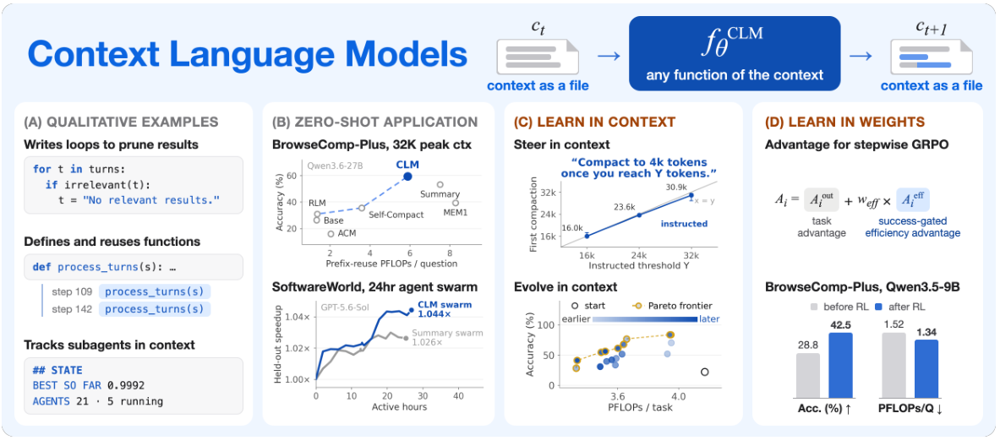
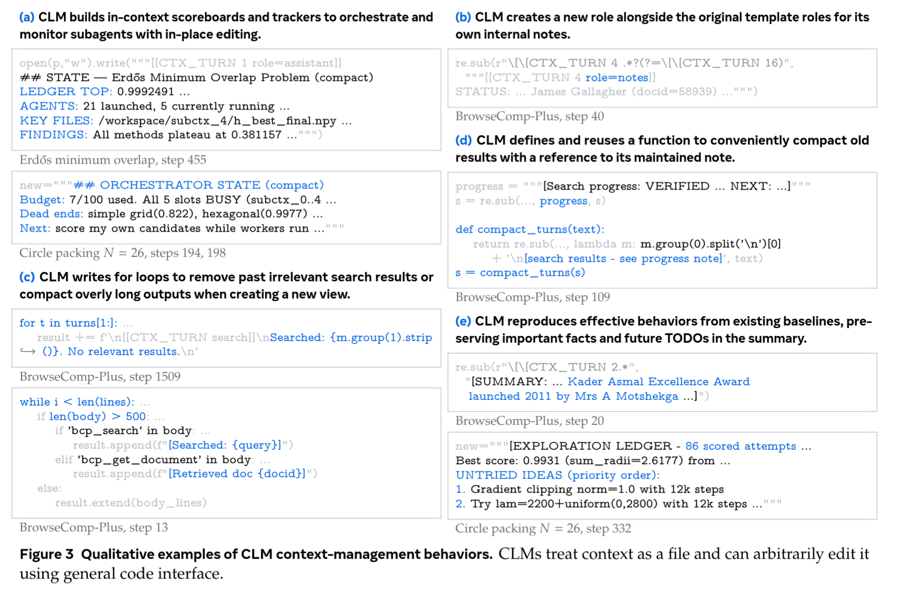
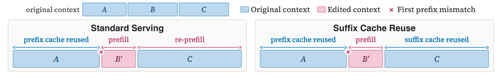
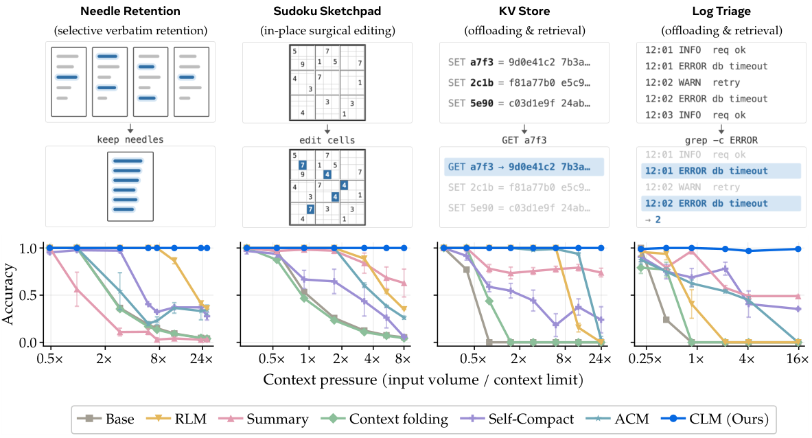
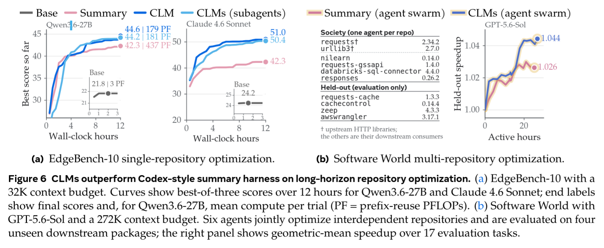

# Context Language Models
https://arxiv.org/abs/2609.37725
(まとめ @cohama)

# 著者

- Rulin Shao
- Shannon Zejiang Shen
- Junjie Oscar Yin
- Yuetai Li
- Minheng Wang
- Hamish Ivison
- Radha Poovendran
- Nathan Lambert
- Teng Xiao
- Mike Lewis
- Wen-tau Yih
- Luke Zettlemoyer
- Pang Wei Koh

# どんなもの？

長時間動くエージェントが、何をコンテキストに残し、いつ書き換えるかを自分で決める研究。
Context Language Models（CLM）は、現在のコンテキストを編集可能なファイルとして公開し、モデルが Bash 経由で自由に更新する仕組み。
既存モデルへの追加学習なしで検索・コード作業の精度と計算効率を改善し、指示文の最適化や強化学習による追加の改善も確認。

# 先行研究と比べてどこがすごい？

- 従来は実行基盤が決めたタイミングや専用ツールで履歴を圧縮する方式。
  - Cursor、Codex、Terminus2 は、一定の長さに達すると決められた手順で要約する仕組み。MEM1 は毎ターン、保持した情報と新しい観測からコンテキストを更新。
  - AutoCompact や Self-Compact は、圧縮するタイミングをモデル自身が判断。ただし、実行するのはあらかじめ用意された圧縮処理。
  - Context-as-a-Tool は、あらかじめ定められた範囲のコンテキストに対し、モデルが専用ツールで圧縮を指示する方式。
  - Agentic Context Management（ACM）は、圧縮するタイミングに加え、削った情報の外部記憶への退避と、必要に応じた検索・取得が可能。
  - Sculptor は、モデルが選んだ断片の要約・非表示化・復元・検索が可能。ただし、メッセージ数や順序は維持する制約。
- これらはモデルに任せる範囲を広げているが、操作の種類や処理内容は専用ツール側で事前定義。CLM は会話履歴全体をファイルとして公開し、モデル自身による編集方法の定義まで可能。
- コンテキストを REPL 変数として扱う方式もある。
  - REPL は Read-Eval-Print Loop の略で、コードの入力・実行・結果の確認を繰り返す対話型の実行環境。
  - Recursive Language Models（RLM）は、長い入力を環境内の変数として保持し、コードで必要な部分を抽出したり、その部分を再帰的なモデル呼び出しで処理したりする方式。
  - モデルが選ぶのは、入力のどこを、いつコンテキストに読み込むか。取得した情報は会話履歴に追記されるため、実行中の履歴自体は増え続ける構造。
  - CLM は、読み込んだ情報や実行中に蓄積した履歴そのものを編集可能。RLM の入力へのアクセス制御と、CLM の履歴編集は相補的な関係。
- 編集による再計算まで含めた効率評価と、指示文・モデルの重みの両方で学べるコンテキスト管理方策。

# 技術や手法の肝は？

## Context-as-a-File

- 現在のコンテキストをファイルに書き出し、そのパスをモデルに提示。
- モデルがそのファイルをBash コマンドなどを通じて編集し、次の推論入力に反映。
- または、編集しない場合は通常どおり出力を追記。
- サブエージェントへの拡張もできる
- 例えば同じコンテキストファイルを共有した複数のサブエージェントに任せたり、サブエージェントごとに別のコンテキストファイルを持たせたりすることも可能。

- CLM が追加学習無しで実際にに行ったコンテキスト編集の例

- a. コンテキスト内で進捗管理
- b. 属性の付与
- c. 複数ある検索履歴をループで処理。例えば検索したが見つからなかったという結果を入れるなど
- d. コンテキスト圧縮を python の関数で実施。同じ関数を使い回す
- e. 要約

## In-Context Learning と強化学習

- どのようにコンテキストを編集するとよいか。
- どのように編集するかの方策を外部テキスト (skill) で与える。また、その skill の内容もモデルで改善
- モデル自身もコンテキスト編集のための能力を強化学習で獲得させる。

## 編集による再計算と Suffix Cache Reuse

- 通常の KV cache は、途中を書き換えるとその位置以降の再計算が必要になるため性能が悪化してしまう。
- 思い切って、編集区間以降のトークンは編集前の情報が残ってしまうことを前提にキャッシュを使いまわす。
- Potision Encoding だけは編集後の位置に合わせて再計算する。

# どうやって有効だと検証した？

## コンテキスト管理そのものを測る

- 重要な行と不要な文章、盤面の変更指示、保存する値やログを、会話の中で順番に与える実験。
- 総入力をコンテキスト上限より長くし、不要情報の削除・状態の更新・外部ファイルへの退避が必要な状況を作る。
- 最後まで重要な行を原文のまま残せるか、変更後の盤面や過去の値・ログを正確に答えられるかで、各コンテキスト管理方式を比較。
- 難しい推論ではなく、情報を正しく整理・保持できるかの診断が目的。
- CLM は高い pressure でもおおむね正答を維持する一方、既存法は情報の欠落や古い情報の蓄積で精度低下（図2）。

## 実タスクで精度と計算量を比較する

- EdgeBench-10 (12 時間かけてあるリポジトリを指定されたスコアに基づいて最適化するタスク) は10課題・各3 seed の最良スコアを評価。
- Software World (複数の依存関係をもつリポジトリを、その依存関係も含めて高速化するタスク) 

# 議論はある？

- 著者が挙げる懸念は、編集可能な履歴に prompt injection や自己生成した不正な指示が残り続ける危険。

## 私見

- モデル自身にコンテキストをファイルとして管理させるというのは単純なアイデアだが有効。とくに KV Cache 使いまわしても性能はそこまで問題ないというのは意外。
- ユーザが実際のトランスクリプトを触ることができなくなるのはどうなんだろう

# 次に読むべき論文は？

- [Recursive Language Models](https://arxiv.org/abs/2512.24601) — Alex L. Zhang ほか。長い入力を外部変数として処理する仕組み。CLM の履歴編集との比較対象。
- [ACM: Agentic Context Management for Long Horizon Tasks](https://arxiv.org/abs/2607.23809) — Xiaochuan Li ほか。専用ツールで圧縮・退避・検索を選ぶ、直接の比較対象。
- [MemGPT: Towards LLMs as Operating Systems](https://arxiv.org/abs/2310.08560) — Charles Packer ほか。階層的な外部記憶とコンテキストの管理を考える基礎。
