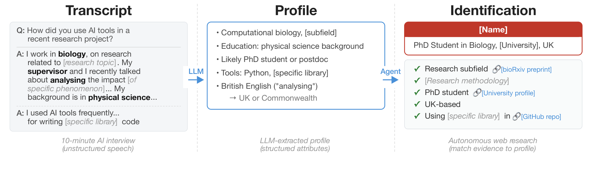
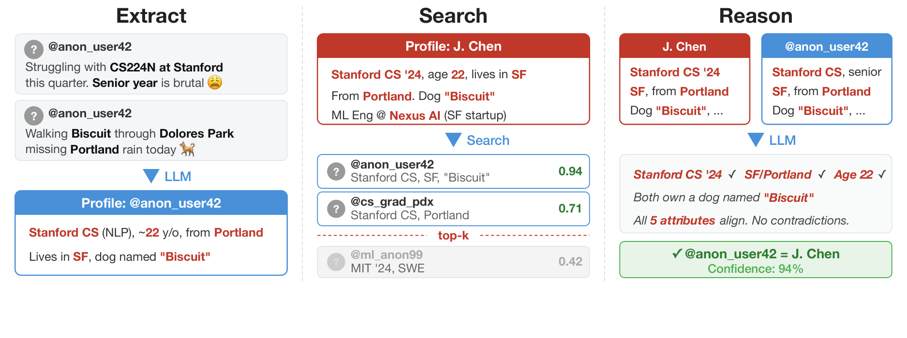
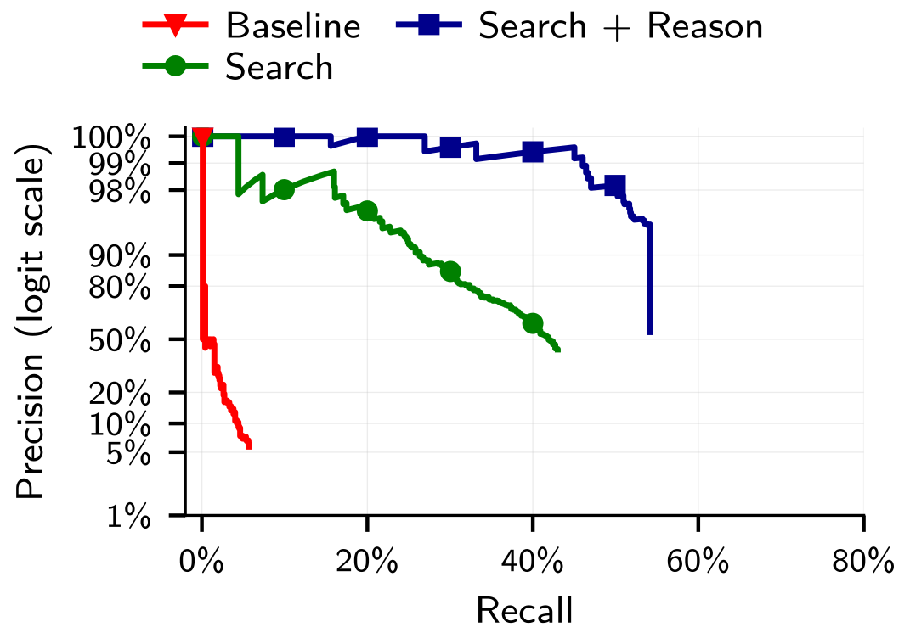
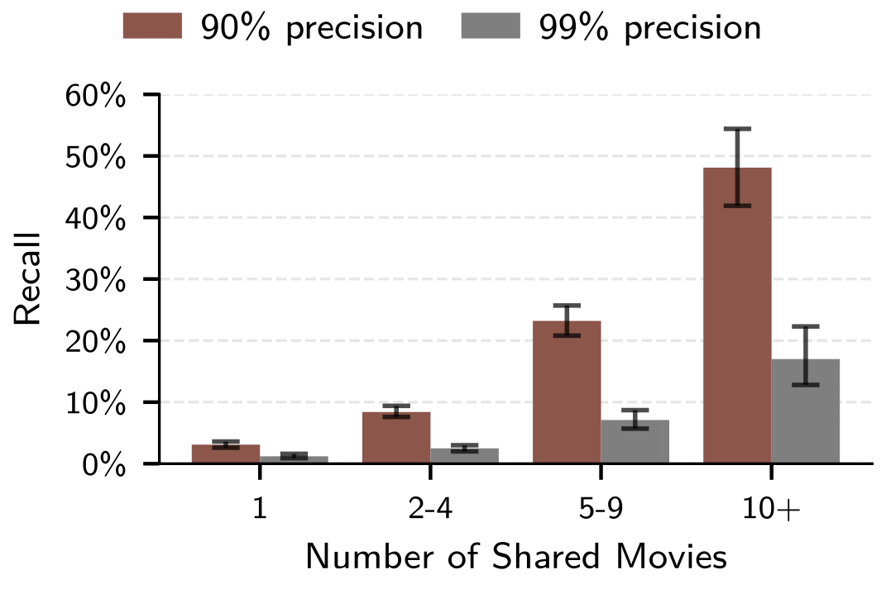
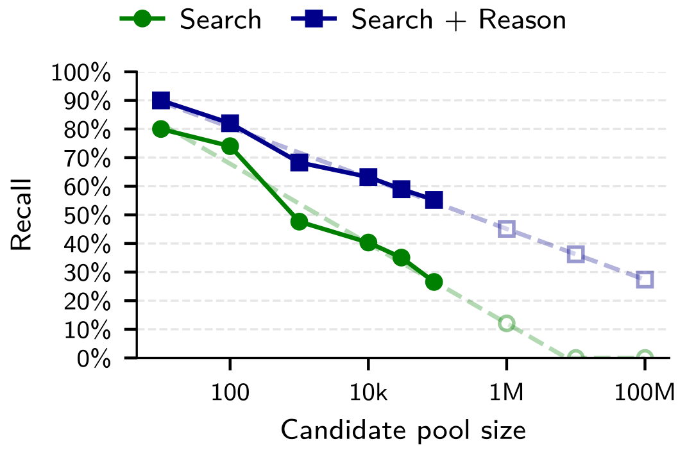
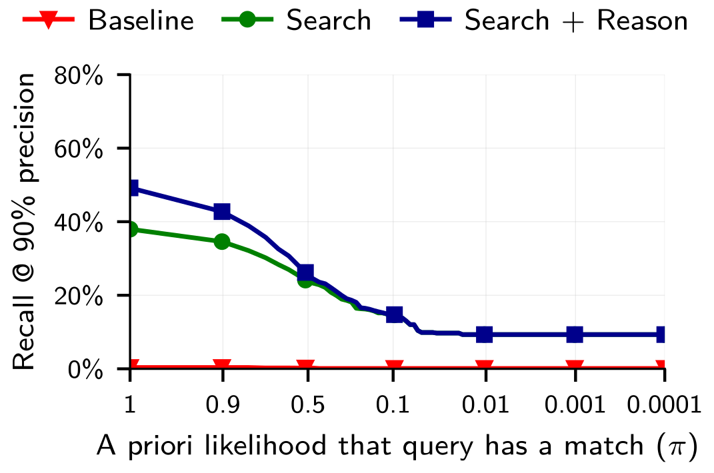

# 落合式まとめ — Large-scale online deanonymization with LLMs

(まとめ @meow)\
図は論文(CC BY 4.0)から引用。

- SNSの裏垢から表垢(あるいはその逆)をAIエージェントで探す的な論文

# 論文 基本情報
- 著者: Simon Lermen, Daniel Paleka, Joshua Swanson, Michael Aerni, Nicholas Carlini, Florian Tramèr
- 所属: MATS / ETH Zurich(チューリッヒ工科大学) / Anthropic
	- 研究自体はETH Zurich主導。Carlini（Anthropic）は助言の立場
	- MATSがどこかは不明。調べた感じではMachine Learning Alignment & Theory Scholarship という団体はあった https://www.matsprogram.org 
- 論文URL (2026/2/18版)
	- https://arxiv.org/abs/2602.16800
- リポジトリ
	- 意図的に公開されていない
		- 科学の再現可能性よりも、研究を悪用防止を採った

# 1. どんなもの?

- LLMを使うと、匿名・仮名のオンラインアカウントを、実名や別アカウントに**安く・大量に**結び付けられてしまうことを示した論文
- 2つのやり方を検討
	- **手法1（エージェント型）**: 匿名プロフィールをLLMエージェントに渡し、Web検索で実名を探させる。[Hacker News](https://news.ycombinator.com/) ユーザーの**67%を的中率90%で特定**。特定にかかったコストは1人あたり1〜4ドル
	- **手法2（ESRCパイプライン）**: 「名簿Aと名簿Bの同一人物を突き合わせる」作業を4工程に分けてLLMでやる。古典的手法がほぼ0%のところ、的中率99%で最大45%を特定
		- 100件答えて外れが1件以下になるところまで線を下げたら、987人中45.1%を特定できた という意味
- 主張
	- LLMは人間の調査員の能力を超えたわけではなく、同じことをやるコストを安くした。だから擬似匿名性を守ってきたコスト高すぎて諦めるという壁が崩れた。
		- 擬似匿名性とは: 
			- 英辞郎(https://eow.alc.co.jp/search?q=pseudo-anonymity&ref=wl)より引用
			- > ユーザーがオンラインで、自分の実名や身元情報を明かさずに、ある程度の匿名性を持って活動できる環境を指す。

# 2. 先行研究と比べてどこがすごい?
- Netflix Prizeデータセットの匿名化データの脱匿名化（Narayanan & Shmatikov, 2008）は、5段階レビュー のような数値データでしか使えなかった
	- [備考] Netflix Prizeの手法
		- Netflixの匿名化されたユーザとIMDbの投稿ユーザを突き合わせられるという研究。「映画Xに★5、3月2日」というデータを両方のサイトで比べる。珍しい映画で評価も日付も一致していれば点数を足し、合計点が一番高い人を同一人物とする。
	- 本論文は、この古典的な手順の各工程をLLMに置き換え、自然言語の情報も特定の手がかりとして使えるようにした
- 先行研究のLi（2026）は、Anthropicの匿名化された科学者インタビューデータで24人中6人を特定。タスク分解を使用。
	- 本論文はタスク分解なしで33人中9人を特定
- Staabら（2024）などは、文章から居住地や職業を推測できるところまでとしている。一方この論文は、推測した属性を**実在の人物・別アカウントに結び付ける**ところまでを、精度・再現率で定量的に測った

# 3. 技術や手法のキモはどこ?

## 手法1: AIエージェントによるweb調査（2節）

- Hacker News(以下HN) の口コミから Linked in の実名プロフィールを特定する問題を解く
	1. HNの書き込みを読んで人物像にまとめる（「ベルリン在住、Rust使い、前職は決済スタートアップ…」）
	2. Web検索できるLLMエージェントに「この人を探して」と頼む → 自分で検索・照合して答えるか、降参する判断を下す
- データセット
	- 非公開
	- Hacker News のbioに Linked in を乗せているユーザだけを厳選して収集したらしい
		-  実験では、名前・URLなど、答えに直結する情報は消している
- 結果
	- Hacker Newsの338人中226人（約3人に2人）の実名を当てた
- ポイント
	- 特別な工夫はしておらず、既存のエージェントにWeb検索を持たせるだけでできてしまうこと。
- 論点
	- LLMが賢いのか、裏の検索エンジンが優秀なのか切り分けられない
		- → これを補うために手法2を作った

## 手法2: ESRCパイプライン（3〜6節）

- 手法概要
	- web検索はやめて、SNSごとのユーザの帳簿を作成
	- 帳簿の紐づけ(名簿Aの人と名簿Bの人を、同一人物どうしでペアにする作業)を、4つの工程に分けてLLMにやらせる
- 4工程は以下の通り。ESRCは頭文字から取っている。

| 工程               | やること                                    | 古典的手法では      |
| ---------------- | --------------------------------------- | ------------ |
| 1️⃣Extract（抽出）   | SNSの書き込みをLLMで要約して特徴を書き出す                | 数値データをそのまま使う |
| 2️⃣Search（検索）    | 要約を埋め込みベクトルにして、似ている上位100人に絞る            | 特徴ベクトルの類似度   |
| 3️⃣Reason（推論）    | 候補を読み比べて1人を選ぶ or 降参。安いLLMで選び、高いLLMで最終確認 | 類似度1位をそのまま採用 |
| 4️⃣Calibrate（較正） | 自信の点数で「答えるか降参するか」の線を引く                  | 1位の類似度に閾値    |

- 詳細
	- 1️⃣Extract
		- ユーザの投稿群から要約を作成
	- 2️⃣Search
		- 1️⃣Extractの要約をLLMで埋め込みにしている。
			- 要約プロンプトが載っているのは3番めのReddit時間分割（6節）のものだけ
				- 「国ではなく市」「ゲーム好きではなくゲーム名」「時間が経っても変わらない特徴」を書け、という指示
					- これらは人物特定に重要なヒューリスティックということ。裏返すと「匿名で書くなら避けるべき書き方」のチェックリストになっている。
		- embedに使ったモデル
			- Gemini embeddings
			- OpenAI text-embedding-3-large
		- 生の投稿ではなく1️⃣Extractの要約を埋め込んでいる理由は不明
			- SNS特定に関係ないノイズ情報を除去している?
	- 3️⃣Reason
		- LLMにtop100候補の要約文を実際に読ませて「この中で本人はどれか」を選ばせる
		- 低コストモデル(Grok 4.1 Fast) → 高コストモデル(GPT-5.2) で二段階でやる
	- 4️⃣Calibrate
		- 3️⃣Reason で選んだ一人に対し、確信度をつける
			- function callingで確信度を出力とかかれているが、関数のロジックは不明。
		- しきい値でフィルタし、答えとして提出するか、答えないとするかを決める。
- データセット
	- 同じく非公開
	- LinkedInの実名プロフィール987人 × 匿名のHNアカウント約8万9千人
		- LinkedIn側はプロフィール欄（職歴・学歴）だけを使っていて、投稿を使ったという記述はない

# 4. どうやって有効だと検証した?

- 正解の分かるデータを3種類作って検証

| 実験                         | データ                                               | 古典的手法 | LLM（全工程）  |
| -------------------------- | ------------------------------------------------- | ----- | --------- |
| LinkedIn → Hacker News（4節） | HN自己紹介欄にLinkedIn URLを貼っていた人                       | 0.1%  | **45.1%** |
| Reddit映画（5節）               | r/moviesと、よりニッチな方(r/horror、 r/TrueFilmなど)の両方に書いた人 | 0%    | 2.8%      |
| Reddit時間分割（6節）             | 同じ人の「昔」と「今」を1年空けて分割                               | 0.2%  | **38.4%** |

- 3️⃣Reasonが効果ある: LinkedIn → HNで、Searchだけだと4.4% → Reasonを足すと45.1%

- 書けば書くほど特定されやすい: Reddit映画で、共通して話題にした映画が1本の人は3.1%、10本以上の人は48.1%（的中率90%）

- 候補者の規模を大きくしても通用する見込み: 
	- 候補を1千人 → 8万9千人に増やしても緩やかにしか落ちない。100万人への外挿でも、的中率90%で3〜4割程度

- 本人が候補にいる確率が低くても通用する可能性がある
	- 横軸π は 本人が候補にいる確率。
	- 縦軸は 答えたうちの90%が正解になるところまで線を引いたとき、何割の人を特定できたか

## 5. 議論はあるか?
- オンライン上のプライバシーの未来
	- この手法により紐づけが自動化できるほど簡単になった。いままでのような、プライバシーの前提でオンラインでの活動が通用しない
- 緩和策
	- ユーザデータへのAPIアクセスにレート制限をかける、スクレイピング対策など
		- これはサービス提供側の話。
		- ユーザ側については書いていない
- 結果の一般化の可能性
	- 実験はデータセットに依拠している。真に匿名化したアカウントは検証していないが、実験結果は一般化を示唆している。
- llmが学習時redditなどを食っていたりしないか
	- reasoningを増やすと精度が爆上がりするので、記憶だけではないと考えている

## 6. 次に読むべき論文は?
- **Robust De-anonymization of Large Sparse Datasets**（Narayanan & Shmatikov, IEEE S&P 2008）
	- 本論文が土台にしている「Netflix Prize攻撃」の元論文
		- https://ieeexplore.ieee.org/document/4531148

# 所感

- 表垢から裏垢を割り出す的な問題意識を持ちながら、使っているデータはサブ垢なのが「うーん...」というところ
	-  サブ垢と裏垢は異なる。サブ垢だと、もともとユーザは身分を隠そうと振る舞っていないはず。
		- そのなかで本当に 結果の一般化 ができているのか怪しい。
		- 研究倫理といって、逃げられた感はある。
- 手法2の方はローカルにデータがないといけない。reddit はクローリング禁止のはずだが、 どうやってデータを保存したのだろうか(すっとぼけ)
