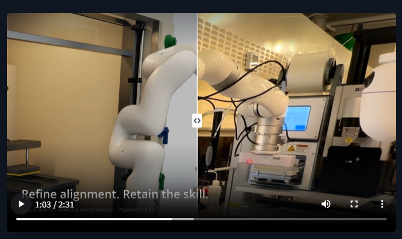
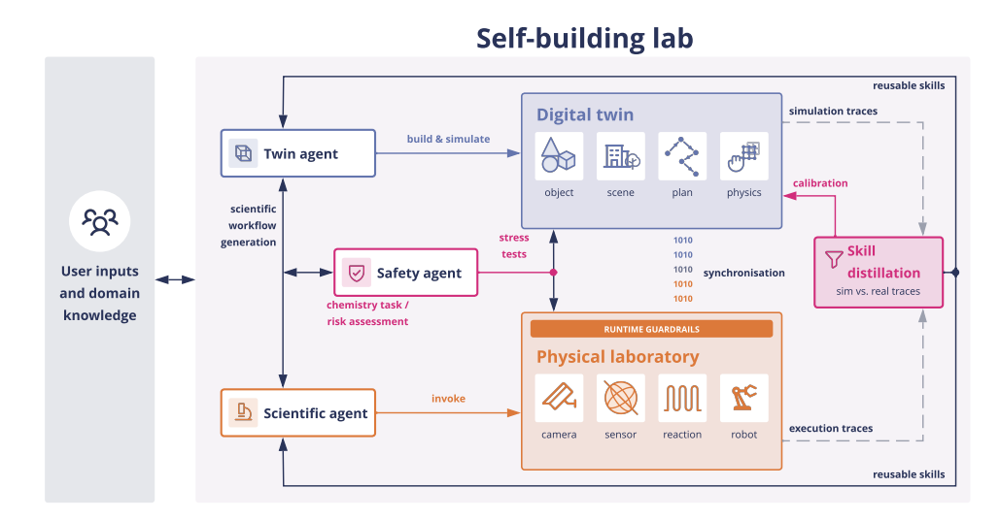
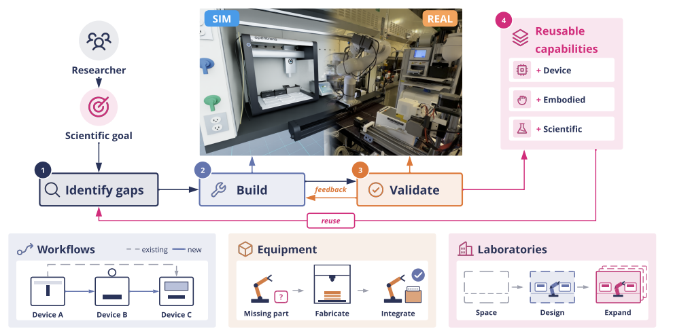
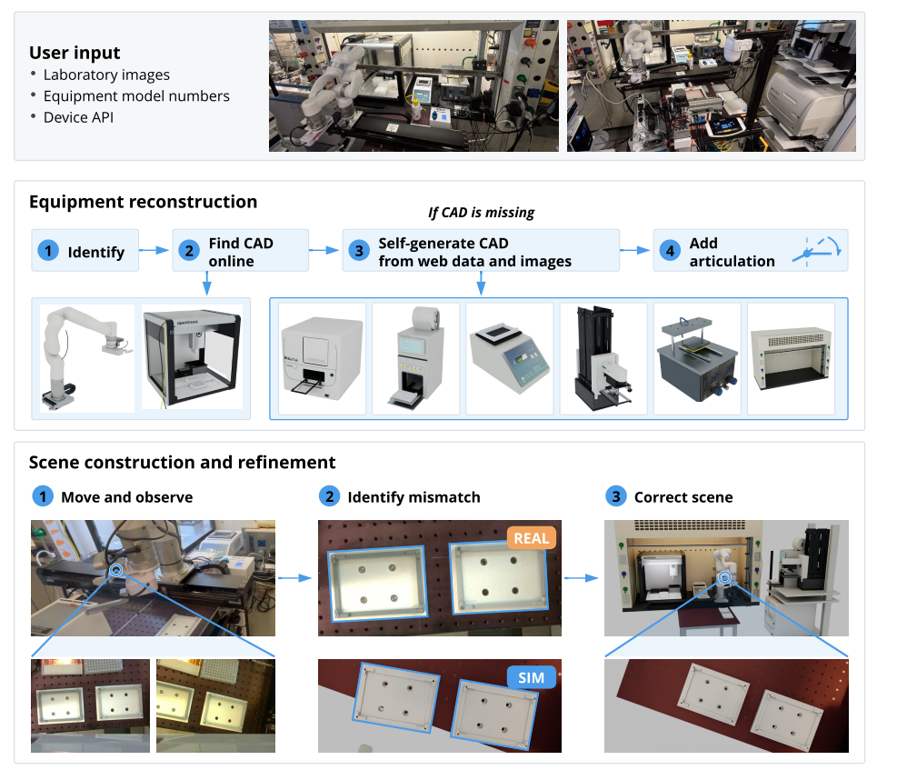
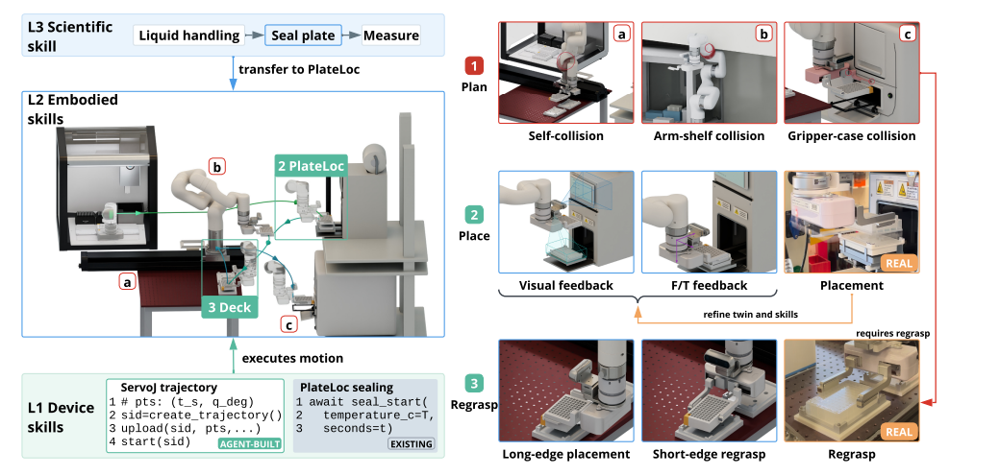
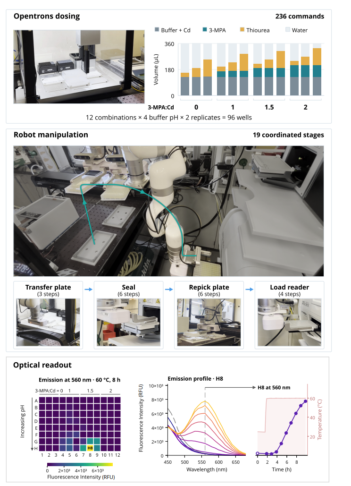
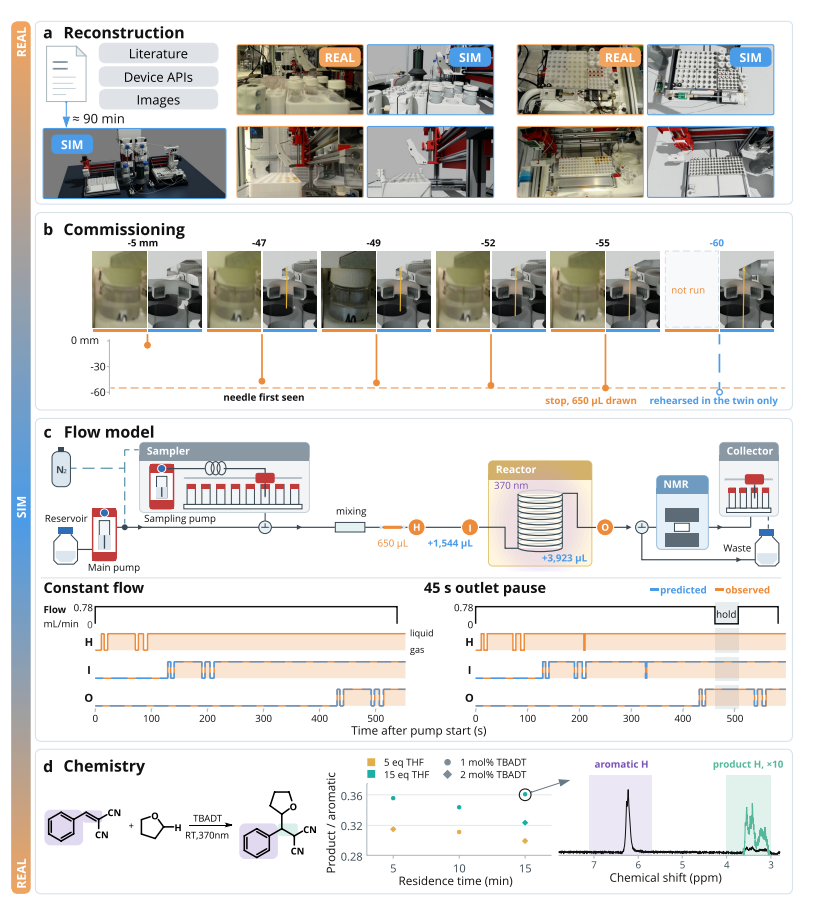
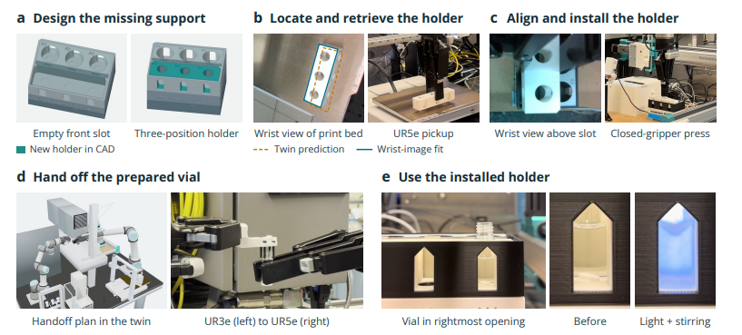
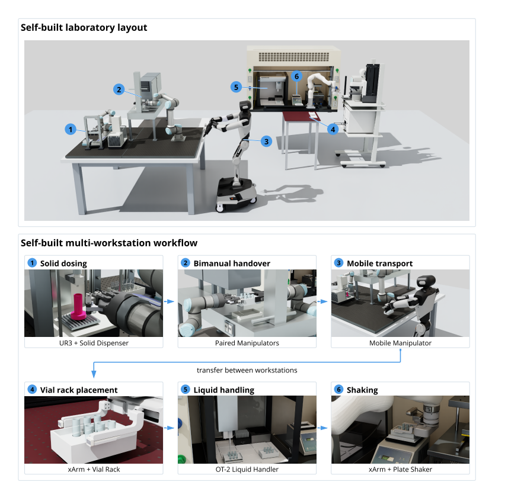

# Self-Building Labs

https://arxiv.org/abs/2610.23826
(まとめ @n-kats)

# 著者
* Jiaru Bai
* Yuchi Zhao
* Yang Cao
* Han Hao
* Elia Savino
* Miroslav Bogdanovic
* Geyuan Xie
* Xiaoman Guo
* Derk H.W. ten Klooster
* Simone Pilon
* Timothy Noël
* Varinia Bernales
* Alán Aspuru-Guzik

トロント大学（コンピュータサイエンスやAI以外に、化学系の人も）、アムステルダム大学、CIFAR、NVIDIAのメンバー。

# どんなもの？
化学系の実験室をAIで回すだけでなく、まっさらな部屋から実験室を設計して、柔軟な実験ができるAIベースの研究環境を作ることが目標。
（SBL=self building labs）

https://self-building-labs.github.io/

いろんな実験室のシミュレーションがリンク先にある。

# 先行研究と比べてどこがすごい？
よくある自動研究だと、既存シミュレーターと実際の実験ツールの操作をすることに取り組んでいて、実験環境が固定されている。

しかし、実際の研究だと、行程を変更しながら試行錯誤する。パラメータ調整にとどまらず、実験室まで作ってしまうというアイデアが特徴。

（似た研究はあるっぽい）

# 技術や手法の肝は？
## 基本構造

* 入力・・・実験の目標と分野の知識
* デジタルツイン・・・シミュレーター上で実験室を作る
* 実験スキル・・・機材の操作。シミュレーションと実際の実験室のフェードバックをもとに調整（そのためにリアル環境ではカメラなどのいろんな観測機器をつける）
* 安全機構

## デジタルツインの構成

* 個々の機器のモデルを用意・・・実験室の画像や、使える機器の型番を参考に
  * CADモデルやURDF（ロボット向けの形式）ファイルを検索
  * 無かったら、近似3Dモデルを構築（AIエージェントが
    * 各種、観測値から寸法を推定
    * 機器を個々のコンポーネントに分解
    * 見た目の検証・調整
* シーンの構成
  * 実験室のレイアウトをもとに、初期案をつくる
  * カメラを配置して、レンダリングしたビューを比較して、修正
* 操作
  * APIインターフェース（リアルに合わせる）

あたらしい観測データが利用可能になるたびに調整する

## 実験スキルの習得

実験スキルは、
* L1 実行インターフェース
* L2 具体的な操作
* L3 科学的手順

のように異なる階層のものがある。

シミュレーターと実ロボットを使ってスキルを開発する。
* シミュレーションと実世界のギャップ（キャリブレーション・モデリングの差）がある。
* 単に何かを配置するだけでも、位置を間違えてぶつけたりとかがないようにしないといけない（持つにはミリ単位の操作が必要）。
* だからといって、ずっとAIが動いているわけにもいかない。

動きはコードとして作り、実行結果のフィードバックをそこに反映する。逸脱した場合だけエージェントを呼ぶ。

## 安全ガードレール

人間がいる環境の場合、安全性が重要。

シミュレーション・物理実行で安全機構を組み込む。
* 衝突を避ける
* AIに危険シナリオを提案・評価させてガイドラインを生成して、それを検証・反映する。
* 人間のオペレーターが全体を強制停止できる
* 速度制限・力制限（とその監視）

## ワークフローの構築
論文では、CdSを使った量子ドット合成の実験をしている（数ナノメートル）の小さな半導体粒子（ディスプレイなどに使うらしい）。

画像では、プレートや中間プレートホルダーを移送して、プレートをアームが持って、スロットに入れるという動作をしている。8時間後の色を観測する。

Opentronsという機械？（左上）とそのシミュレーターを使う。
236個のコマンドがあり、タイムスタンプをつけて実行を管理（デバイスの状態を記録）。
タイムスタンプの順で実行する（前のコマンドの完了はちゃんと待つ）。

## 実験環境の構築
既存のSDL(self driving laboratory）のRoboChemFlexに渡して研究を進める（実験環境が決まったら既存手法が使える

* デジタルツインを構築（90分）
* シミュレーションと実環境で試行
* 予測モデルをたてて、実測と比較
* 結果を分析

## 機器の追加
シミュレーションをしていると、機材の不足を発見することがある。

3Dプリンター（Bambu Lab A1）で、足りない機器を作った。

バイアル（容器）を保持するホルダーが必要と分かって追加。

## その他
* model・・・gpt6-astra
* デジタルツイン・・・NVIDIA Isaac Sim 6.1（USD（Universal Scene Description）でシーン表現）
* ロボットの動作計画・・・cuRobo

# どうやって有効だと検証した？

https://self-building-labs.github.io/
の動画などが実例。

複数ロボット環境も実験

# 議論はある？
キャリブレーションが不十分な場合も、フィードバックを活用して調整するのが特徴。

観測と検証ができるのがエージェントに向いた環境。

デジタルツインを使うことが安全性に寄与する。

途中、エージェント同士の意見が合わなかったりする場合があった。

人間は、研究目的と環境内でわからない事実を提供するのが役目。

デジタルツイン試算や安全ガイドラインなど、共有できるものがあるのも価値がある。

遠隔地や汚染されたっ危険な場所などでの研究に役立つ可能性がある。

## 私見
AIエージェントで画像からデジタルツインを作るというアプローチが面白いし、汎用性がある。

AIエージェントに3Dモデリングさせたり、3Dプリンターで機器を追加したりというあたりが面白い。

完全にゼロから作るわけではない（既存のアームとかは必要）

# 次に読むべき論文は？
* RoboChemFlex ・・・ 実験自体を回している方？