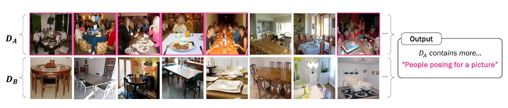
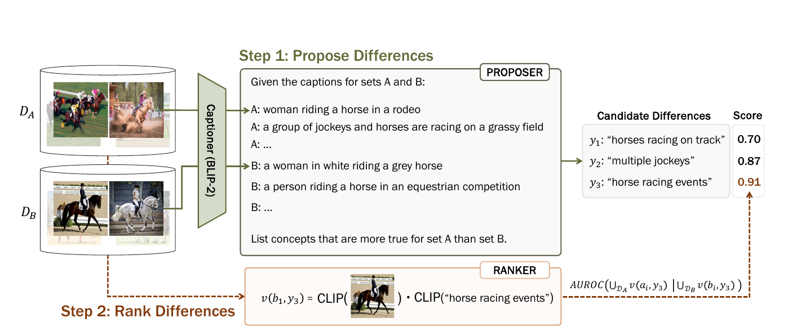
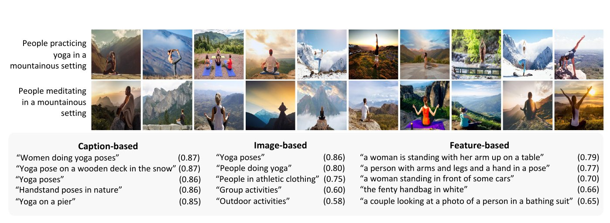
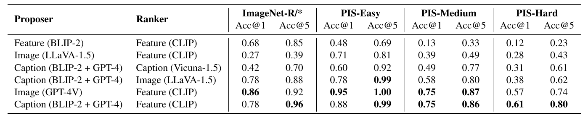
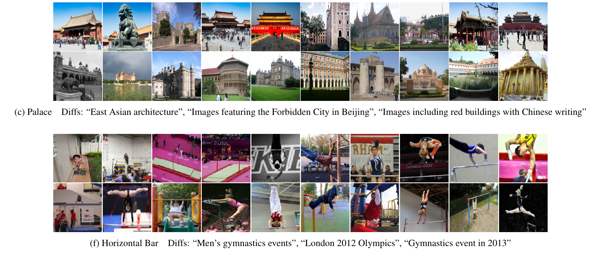
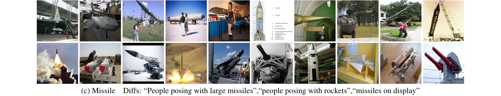
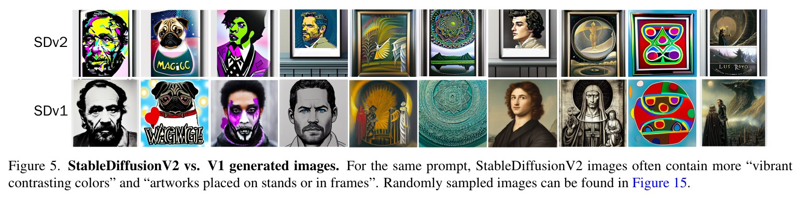
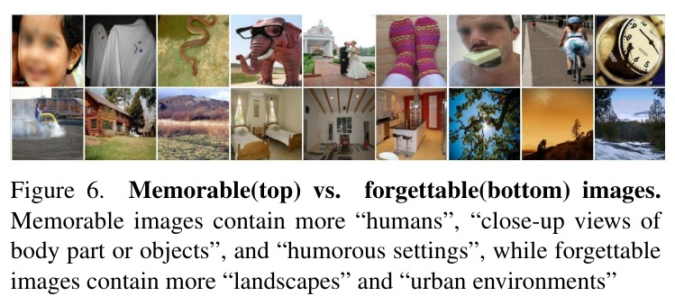

# 落合式まとめ — Describing Differences in Image Sets with Natural Language（VisDiff）

(まとめ @meow)
図は論文（CC BY 4.0, https://creativecommons.org/licenses/by/4.0/）から切り出して引用。

- 2つの画像の山を渡すと、片方に多いものを言葉で教えてくれる仕組みを作った論文

# 論文 基本情報
- 著者: Lisa Dunlap*, Yuhui Zhang*, Xiaohan Wang, Ruiqi Zhong, Trevor Darrell, Jacob Steinhardt, Joseph E. Gonzalez, Serena Yeung-Levy（*同等の貢献。著者順はコイントスで決定）
- 所属: UC Berkeley / Stanford
- 会議: CVPR 2024（Oral）
- 論文URL（2024/4/26 版）
  - https://arxiv.org/abs/2312.02974
- プロジェクトページ
  - https://understanding-visual-datasets.github.io/VisDiff-website/
- リポジトリ
  - https://github.com/Understanding-Visual-Datasets/VisDiff（Apache 2.0）
  - ベンチマーク VisDiffBench も公開されている

# 1. どんなもの?

- 2つの画像集合 DA と DB を渡すと、DB より DA によく当てはまる特徴を自然言語で返す、というタスクを定義した
  - Set Difference Captioning（集合差分キャプショニング）と命名
  - 図1の例: ImageNetV2 と ImageNet の食卓クラスを比べると、V2 側には people posing for a picture（写真のためにポーズをとる人々）が多い
- このタスクを解く手法 VisDiff と、評価用のベンチマーク VisDiffBench（187組）を作った
- 実際のデータセットやモデルに当てて、これまで知られていなかった違いをいくつも見つけた
  - 例: Stable Diffusion v2 は v1 より白い枠や額縁の付いた画像を多く生成する
- 主張
  - データセットの違い、モデルの得意不得意、生成モデルのクセなど、多くの分析は2つの画像集合の違いを見つける問題に置き換えられる。それを自動化すれば、人間が何千枚も見比べなくても洞察を量産できる

# 2. 先行研究と比べてどこがすごい?
- 2枚の画像の違いを言葉にする研究（difference captioning, change captioning）はあった。GPT-4V のような VLM も少数の画像なら違いを語れる
  - 本論文は、何百〜何千枚という集合同士の違いを扱う
- 大量の画像の傾向をつかむ研究（代表画像を見つける、画像を平均する、検出器で統計を取るなど）もあった
  - ただし自然言語では説明してくれなかった。本論文は柔軟で読みやすい自然言語で返す
- テキスト集合の違いを LLM で記述する D3 / D5（共著者の Ruiqi Zhong らの研究）の枠組みを、画像に持ち込んだ
- 画像で同じことを狙った GS-CLIP は、あらかじめ用意した文のリストから選ぶだけだった
  - 本論文は LLM に自由に候補を書かせるので、記述の表現力が高い
  - さらに評価用のベンチマークをきちんと作って比較した

# 3. 技術や手法のキモはどこ?

- 数千枚を一度に入れて推論できるモデルはないので、仕事を2段に分ける
  - Proposer: 少数のサンプルを見て、違いの仮説を自由に出す（発想担当）
  - Ranker: 出た仮説を全画像で採点し、本当に効いているものを上に並べる（検証担当）

## Proposer（仮説を出す）
- 各集合から20枚ずつランダムに取り出す
- BLIP-2 で各画像にキャプションを付け、GPT-4 に DA に多い概念を10個挙げさせる
- これを3ラウンド回して約30個の候補を集める
- プロンプトの工夫
  - 仮説は CLIP にそのまま入れられる短いキャプションの形で書かせる
  - more of ... や presence of ... のような言い回し、括弧での列挙は悪い例として示し、直し方も添える
  - Ranker が CLIP なので、出力の形を CLIP の入力に揃えている（プロンプト名も CLIP_FRIENDLY）

## Ranker（仮説を採点する）
- 各仮説 y と各画像 x について、CLIP で画像と仮説文のコサイン類似度 v を出す
- DA 側と DB 側の v を比べて、仮説ごとにスコアを1つ出す
  - スコアは AUROC。DA から1枚、DB から1枚選んだとき、DA の画像のほうが y に似ている確率
  - 0.5 なら区別できない、1.0 なら y だけで2集合を完全に分けられる
- 同じ v に Welch の t 検定もかけ、有意でない仮説（p ≥ 0.05）は捨てる
  - AUROC は差の大きさ、t 検定は差が偶然でないか、を見ている
- 残った仮説を AUROC の高い順に並べて出力

# 4. どうやって有効だと検証した?

## VisDiffBench での評価

- VisDiffBench: 正解の違いが付いた187組の画像集合ペア
  - 主体は PairedImageSets の150組。GPT-4 に文のペアを作らせ、Bing の画像検索で各100枚を集めた
  - Easy（犬と猫）、Medium（SUV とセダン）、Hard（ヨガと瞑想、サーモン寿司とマグロ寿司）が各50組
  - 残りの37組は ImageNet-R と ImageNet* 由来
- 採点は GPT-4 に 0 / 0.5 / 1 で判定させる。人間の採点とのピアソン相関は 0.80
- 指標は Acc@k（上位 k 件の中で最も良いスコア）

- 最終構成（キャプション経由の Proposer と CLIP の Ranker）の成績
  - Acc@1: Easy 0.88、Medium 0.75、Hard 0.61
  - Acc@5: Easy 0.99、Medium 0.86、Hard 0.80
- GPT-4V の画像 Proposer も強いが、Hard で僅差で負けるうえ高価なので不採用

## 実データへの応用（6章）
正解のない問題に当て、出てきた仮説を別の手段で裏取りしている。

| 応用 | DA / DB | 見つかった違い | 裏取り |
|---|---|---|---|
| ImageNetV2 と ImageNet | V2 全体 / ImageNet 全体 | photos taken from Instagram。V2 の一部は2012〜14年に集められ、SNS 風の写真が多い | メタデータ分析（V2 の画像は2012〜14年のアップロード） |
| CLIP と ResNet | CLIP だけ正解した画像 / それ以外 | 画像内の文字やラベル、物体の角度、人が写っている場面に CLIP は強い | 既存研究と整合 |
| ResNet の失敗モード | ResNet が間違えた画像 / 正解した画像 | 人が写っている画像で間違えやすい | DETR で人の有無を判定すると、人ありで精度が3〜4%低い |
| SDv2 と SDv1 | SDv2 の生成画像 / SDv1 の生成画像 | 色が鮮やかで、白い枠や額縁が多い | 平均彩度、エッジ検出で白い線（v2 13.6%、v1 5.4%） |
| 記憶に残る画像 | 記憶されやすさ上位25% / 下位25% | 人、クローズアップ、ユーモアは覚えられやすく、風景や都市は忘れられやすい | 差分記述で分類すると89.8%の精度 |

VisDiff の出力が実際にどう見えるかを、論文の図から4つ引用する。各図で、画像の下の文（またはキャプション中の語句）が VisDiff の出力した差分。

ImageNetV2 と ImageNet の比較（Palace クラスと Horizontal Bar クラス）。上段が V2、下段が ImageNet。V2 側は中国風の建築が多く、体操の競技会の写真が多いと、画像を見比べた結果と同じ差分が文で出ている。

CLIP が正解して ResNet が間違えた画像（上段）と、それ以外の画像（下段）の比較（Missile クラス）。CLIP が強いのは、人が大きなミサイルと並んで写っている画像だと分かる。

同じプロンプトから生成した Stable Diffusion v2（上段）と v1（下段）の比較。v2 は色のコントラストが強く、額縁や台に置かれた作品風の絵が多いという差分が、図の下のキャプションに書かれている。

記憶に残りやすい画像（上段）と忘れやすい画像（下段）の比較。人、体の一部や物のクローズアップ、ユーモラスな場面が覚えられやすく、風景や都市は忘れられやすいという差分が、図の下のキャプションに書かれている。(※おそらく人物はプライバシーの関係でぼかし加工されている)

# 5. 議論はある?

## 論文が認めている限界（7章、付録E）
- キャプションにした時点で細部が落ちる
  - バタークリームとフォンダンのカップケーキの違いは、汎用的なキャプションのせいで見落とされた
- GPT-4 が画像ではなくキャプション文の特徴を拾うことがある
  - repetition of 'bonsai' in the caption のような仮説が出てしまう
- CLIP は位置関係が苦手で、言い回しのわずかな違いで類似度が大きく変わる
- AUROC は外れ値に引っ張られ、具体的すぎる仮説（seagulls in flight）が一般的な仮説（birds in flight）より上に来ることがある
- VisDiffBench は物、スタイル、動作の違いが中心で、位置、大きさ、画質の違いは含まれない。ウェブから集めたのでノイズもある
- 人が結果を解釈する前提の支援ツール。CLIP、GPT、BLIP のバイアスや誤りを引き継ぐ

# 6. 次に読むべき論文は?
- D3: Zhong et al., Describing differences between text distributions with natural language（ICML 2022）
  - VisDiff の Proposer / Ranker の枠組みの元になった、テキスト版

## 所感

- 画像だと難しいXAIっぽいことできそうでよさそう
- 2026年の今なら部品の置き換え余地は大きい
  - キャプション生成と Proposer は Qwen3-VL など最新の VLM に、Ranker は SigLIP 2 などに
  - 多数の画像を個別に入力できる VLM なら、論文で負けた画像を直接見る方式を再評価する価値がある
  - Ranker を道具として渡し、仮説の点検、残差の分析、画像編集による介入実験までをループで回すエージェント版も考えられる

