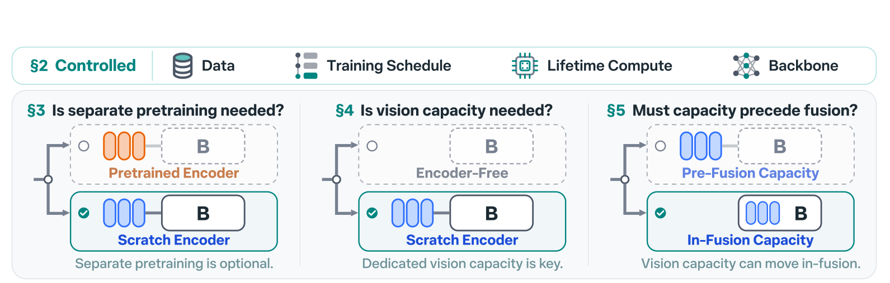
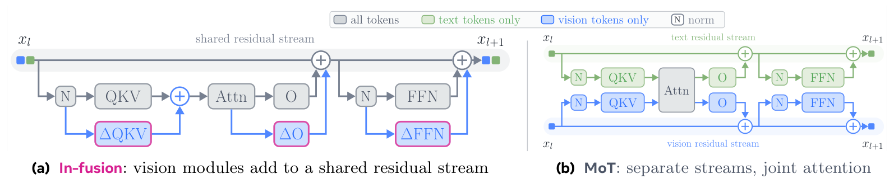
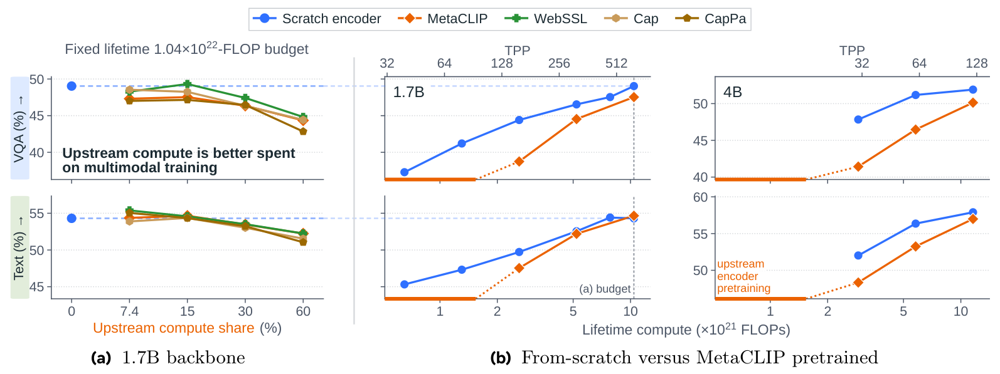
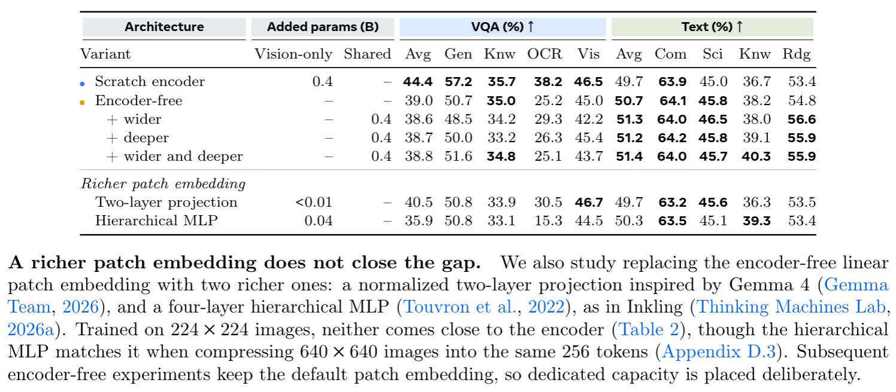
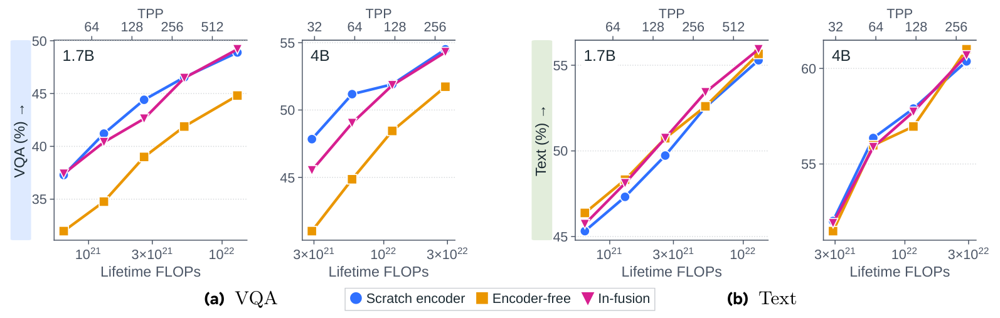

# Unbundling Multimodal Vision Encoding
https://arxiv.org/abs/2611.17334v1
(まとめ @cohama)

# 著者

- Ellis Brown
- Chris Hoang
- Shengyi Qian
- Shang-Wen Li
- Mike Lewis
- Marjan Ghazvininejad
- Luke Zettlemoyer
- Lucas Beyer
- Mengye Ren
- Jakob Verbeek
- Saining Xie
- Hu Xu

# どんなもの？

- マルチモーダルモデルで、Vision Encoder の設計がどの程度画像の理解に効くかを調べた研究。
- 別工程での事前学習の有無、画像トークン専用のパラメータの有無、そのパラメータを置く場所を変え、総学習計算量をそろえて比較した。
- 画像とテキストを受け取って次のテキストトークンを予測するモデル本体を、バックボーンと呼ぶ。バックボーンの重みをすべて共有する Encoder-free と比べると、画像専用の処理を持つ構成は、特に文字やグラフの読み取りに強かった。
- 画像専用の処理をバックボーンの先頭8層に置くと、独立した Vision Encoder と同程度の画像理解性能を保ち、計測条件によっては最初のトークンを返すまでの時間も短縮できた。

# 先行研究と比べてどこがすごい？

- マルチモーダルモデルには、画像を処理する設計に次の違いがある。
  - PaliGemma は事前学習済みの Vision Encoder を接続する。
  - Kimi K3 は Vision Encoder をバックボーンと一緒に初期状態から学習する。
  - Fuyu-8B は画像パッチをバックボーンに直接入力する。
- これらのモデルは学習データや計算量も異なる。本論文はデータと総学習計算量をそろえ、同じバックボーンを使って画像の処理方法を比較した。
- 比較の研究もある。
  - Cambrian-1 は20種類以上の事前学習済み Vision Encoder を比較し、画像中心の評価方法も整備した。本論文は、同じ Vision Encoder を使って事前学習の有無を比べる条件に加え、画像専用のパラメータ数をそろえて処理の配置だけを変える条件を設けた。
  - Shukor らは独立した Vision Encoder の有無などを変え、学習計算量に対する検証損失の変化を調べた。複数のデータ種別をまとめた平均損失では画像理解の差が見えにくいため、本論文は画像キャプションの損失と画像質問応答でも比較した。

# 技術や手法の肝は？

## 基本構成

- まず、画像トークンとテキストトークンを受け取り、次のテキストトークンを予測する Qwen3 系のバックボーンを共通にする。
- 画像をパッチに分けてテキストの前に並べる。同じ画像内のパッチ同士は双方向に参照でき、テキストは画像を含む先行トークンを参照できる。
- この共通設計を土台に、画像パッチをどこで処理するかと、独立した Vision Encoder を使う場合の学習方法を変える。

| 構成 | パッチの入力経路 | 追加の画像専用パラメータ | 別工程の事前学習 |
| --- | --- | --- | --- |
| Pretrained encoder | Vision Encoder を通してからバックボーンへ | バックボーンの手前 | あり |
| Scratch encoder | Vision Encoder を通してからバックボーンへ | バックボーンの手前 | なし |
| Encoder-free | 線形射影したパッチをバックボーンへ直接入力 | 追加なし | なし |
| In-fusion | 線形射影したパッチをバックボーンへ直接入力 | バックボーンの先頭8層 | なし |

Pretrained encoder と Scratch encoder は同じ27層の Vision Transformer（ViT）を使う。17億と40億のバックボーンでの比較では、独立した ViT と In-fusion の画像専用パラメータを約4億にそろえる。
In-fusion は Encoder-free と同じ入力経路に、画像トークンだけが使う処理を上乗せした構成。

## 学習データと計算量をそろえる

- 主な実験では17億と40億パラメータのバックボーンで各構成を比較。マルチモーダル学習では、ウェブ由来のテキストコーパス Nemotron-CC と、ウェブ画像と説明文のペアを集めた MetaCLIP 1.2 を使う。画像の説明文は Qwen2.5-VL で付け直し、テキストのみの入力と画像付きの入力を 70:30 で混ぜる。
- Vision Encoder の単独事前学習にも同じ画像を使う。次の4方式でそれぞれ別の Vision Encoder を学習し、その後のマルチモーダル学習で比較する。
  - MetaCLIP は画像と対応する元の説明文の表現を近づける対照学習。
  - WebSSL は画像だけを使い、自己蒸留とマスクしたパッチの予測で学習。
  - Cap は画像から元の説明文を1トークンずつ予測。
  - CapPa は1トークンずつの予測と、全文を並列に予測する学習を組み合わせる。
- マルチモーダル学習の計算量だけをそろえると、単独の事前学習を行った構成はその分多く計算を使える。そこで事前学習も含む総 FLOPs をそろえ、同じ予算を別工程と共同学習のどちらに配分するのが有利かを調べる。各構成に同じ手順で行う評価用の指示チューニングは予算の外に置く。

## 画像専用の処理をバックボーン内に移す

画像専用パラメータの量を Scratch encoder とそろえたまま、その処理を画像とテキストが相互作用する層まで移せるかを調べる。

- バックボーンの先頭8層で、画像トークンに限り、共有のフィードフォワードネットワーク（FFN）の出力に専用 FFN の出力を加算。
- 既定版は Attention のクエリ・キー・バリュー・出力（Q、K、V、O）の各射影にも画像専用の加算項を置く。Attention 自体は画像とテキストで共有する。FFN-only 版は約4億の追加枠を FFN だけに使う。
- 専用の Attention 射影と専用 FFN の出力射影をゼロ初期化し、学習開始時は共有経路だけが出力に寄与。Mixture-of-Transformers（MoT）はモダリティごとに独立した経路を持ち、Attention で情報を混ぜる。

# どうやって有効だと検証した？

- 画像理解は、画像を見て質問に答える画像質問応答（Visual Question Answering、VQA）で測る。一般・知識・文字認識とグラフ読解・視覚認識の計16タスクを4カテゴリに分け、各カテゴリの平均を等しく重み付けして Avg. VQA とする。
- 言語理解は、テキストだけの常識推論や読解など12タスクで測る。4カテゴリの平均を等しく重み付けして Avg. Text とする。一部の比較では、学習に使っていない画像の説明文をどれだけ予測できるかもキャプション損失で測る。
- マルチモーダル学習では 224×224 の画像を使う。VQA は原則として 448×448 で Cambrian-7M による指示チューニングを3エポック行ってから評価する。
- 質問文だけでどの程度答えられるかを測るため、テキストのみで事前学習した17億モデルに空画像を与えた。指示チューニングと評価の両方で画像をゼロにし、画像トークンの位置は残す。この対照の Avg. VQA は約28点。

## Vision Encoder の事前学習は必要か

- 17億モデルでは、総予算の約15%までを Vision Encoder の事前学習に充てた構成は、全予算で共同学習した Scratch encoder と同程度。60%を充てると画像とテキストの評価がともに下がった。
- 事前学習を予算の外に置く比較では、事前学習を長くすると、画像表現から ImageNet のクラスを線形分類する精度は80.4%から84.4%に上がった。Avg. VQA は事前学習済みの最良条件で43.2点、同じマルチモーダル学習予算を使った Scratch encoder で43.5点だった。

同じ画像を使ったこの比較では、Vision Encoder をバックボーンと最初から共同学習するだけで、別工程の事前学習を行った場合と同程度の VQA を得られた。

図2と図6の上軸の Tokens Per Parameter（TPP）は、同じ計算量でテキストのみのモデルが処理するトークン数を、埋め込みを除いたバックボーンのパラメータ数で割った値。

## 画像専用のパラメータは必要か

- 17億モデルの同一計算量比較で、Avg. VQA は Scratch encoder が44.4点、Encoder-free が39.0点。Encoder-free の共有部に約4億を足した条件では38.6〜38.8点。
- 文字認識とグラフ読解では Scratch encoder が38.2点、Encoder-free が25.2点だった。

同じ約4億のパラメータを追加するなら、共有部分を大きくするより、画像専用の処理に割り当てるほうが画像理解に効いた。

## 画像専用の処理をどこに置くか

- 17億モデルの追加 FFN を画像専用にすると、Avg. VQA は先頭8層で45.0点、最後の8層で35.1点。先頭8層の同じ追加 FFN を全トークンで共有すると42.3点。予算を倍にした比較でも画像専用が上回った。
- 6億〜64億の5規模で In-fusion は Scratch encoder に近い。実験結果にスケーリング則を当てはめると、17億〜64億で同じ Avg. VQA に達するための FLOPs は Scratch encoder を1として Encoder-free が2.6〜3.1倍、In-fusion が1.0〜1.1倍。

画像専用の処理は、バックボーンの先頭8層に置いても、独立した Vision Encoder と同程度の画像理解性能を得られた。

# 議論はある？

- Vision Encoder の事前学習とマルチモーダル学習で同じ画像を使った比較。SigLIP 2 のように、大規模な画像・テキストデータで学習された公開済みの重みを使う利点は、この実験の範囲外。
- 検証した条件は最大64億の dense バックボーンと主に 224×224 の画像による学習。高解像度や文字の多い学習データ、動画、疎な Mixture-of-Experts への拡張は今後の課題。
- 640×640 の画像を256トークンに圧縮する階層型の多層パーセプトロンは、224×224 で指示チューニングする比較で Scratch encoder と同じ Avg. VQA（40.2点）。画像を何トークンで表現するかも結果に関わる。
- 画像付きのリクエストとテキストだけのリクエストを同じバッチで処理する場合、In-fusion の画像専用処理が同じ forward pass に入る。実運用で最初のトークンを返すまでの時間は、リクエストの混ざり方にも依存する。

## 私見

- 文字とグラフの読み取りで差が開くのが面白い。画像理解をまとめた平均点だけを追うと、どの情報が失われたかを見落としそう。
- 次は、文字の多い画像を高解像度で学習させたときに、先頭8層に集中させる設計がどこまで通用するかを見たい。

# 次に読むべき論文は？

- Shengbang Tong ら。視覚中心の評価と Cambrian の4カテゴリの由来。 [Cambrian-1: A Fully Open, Vision-Centric Exploration of Multimodal LLMs](https://arxiv.org/abs/2406.16860)
- Weixin Liang ら。モダリティごとに重みを分ける設計と、共有の重みに画像専用の出力を足す本論文の設計を比較できる。 [Mixture-of-Transformers: A Sparse and Scalable Architecture for Multi-Modal Foundation Models](https://arxiv.org/abs/2411.04996)
- Mustafa Shukor ら。画像とテキストの融合位置を変えたときのスケーリングを扱う。 [Scaling Laws for Native Multimodal Models](https://arxiv.org/abs/2504.07951)
